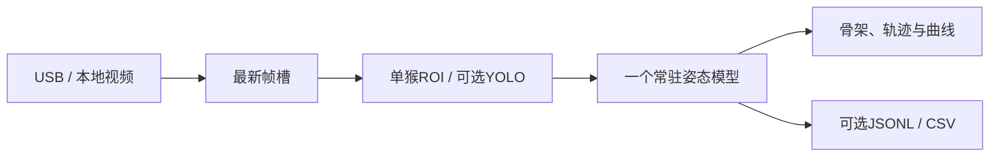

# MonkeyPoseLive

本机运行的猴子 2D 骨架与关节轨迹工具。支持 USB 摄像头和本地视频，保留不同模型的原生点位定义，可查看骨架叠加、近时轨迹和所选关节 X/Y 曲线，按需导出原始坐标。

Local monkey 2D pose and trajectory viewer for USB cameras and video files. The Windows desktop application uses independently configured pose backends; model weights and research media are supplied by the user.

## 远程网页版（0.2）

这台电脑运行模型，其他电脑通过带密码的HTTPS网页上传视频，或发送浏览器摄像头画面。客户端无需安装模型。网页可查看骨架、关节轨迹和进度，并下载JSONL、CSV和叠加视频。上传任务逐帧处理；摄像头一次发送一帧，避免积压，实际速度取决于网络和模型。

使用独立Python环境安装 `requirements-web.txt`，配置好本机模型后，运行 [Start-Web.ps1](Start-Web.ps1)；加 `-QuickTunnel` 创建临时公网HTTPS入口。先用 [Install-WebTunnel.ps1](Install-WebTunnel.ps1) 安装并校验官方隧道工具。停止入口和推理服务使用 [Stop-Web.ps1](Stop-Web.ps1)。完整部署与访问说明见 [WEB_DEPLOYMENT.md](docs/WEB_DEPLOYMENT.md)。

远程服务与桌面API分开：随机密码、会话隔离、同源验证、上传和存储配额；远程客户端不能浏览主机文件、改模型路径或开启主机USB摄像头。视频和结果只保存在主机专用数据目录，不随Git发布。公网隧道中转流量；推理仍在本机。临时网址会随重启变化，适合试用；长期入口需要后续配置。

## Windows 软件

1. 从 [Releases](https://github.com/K1rwo/MonkeyPoseLive/releases) 下载 Windows x64 便携 ZIP，解压整个目录，双击 `MonkeyPoseLive.exe`。
2. 首次打开“模型与路径设置”，为需要的模型指定 Python 环境、模型配置、权重和作者源码目录；也可使用 `config.example.json` 模板。每种模型可以使用独立环境。
3. 选择 USB 和摄像头编号，或选择本地视频路径。选择模型后开始抽出，在画面上框选单猴 ROI。
4. 查看骨架、短时轨迹和关节曲线。需要保存时，在开始前开启坐标保存；结束后读取会话目录的 `predictions.jsonl` 和 `trajectory.csv`。
5. 切换模型前停止；关闭桌面窗口会停止本窗口创建的采集和模型工作进程。

桌面包包含界面、本机服务、视频读取依赖和模型适配器。姿态推理使用用户配置的独立 Python 环境及权重；更换电脑时需要配置这些后端。Windows 原生窗口使用 [Microsoft WebView2 Runtime](https://learn.microsoft.com/en-us/microsoft-edge/webview2/concepts/distribution)。

默认配置在 `%LOCALAPPDATA%/MonkeyPoseLive/config.json`，可用 `MONKEYPOSE_CONFIG` 指定其他本地配置。默认输出在同一应用目录下的 `sessions/`，可在设置中改动。配置和会话不写入程序安装目录。

## 姿态后端

| 模型 | 输出和使用条件 |
|---|---|
| MMPose / MacaquePose HRNet-W48 | 17点；MMPose 0.29 系列的既有猴子权重和对应配置 |
| macaque3Dpose HRNet-W32 | 只使用2D前端；原始17通道，显示15点，两个眼通道不作为已验证点展示 |
| ViTPose++-S AP10K | 保留AP10K动物点位、expert3和associate head2 |
| X-Pose | macaque文本提示；FP32；对象阈值0.1，没有独立逐关节置信度；遵守作者非商业科研许可 |
| DeepLabCut ResNet50 | 用户自己的TensorFlow检查点；CPU、手动ROI；不附带猴子专用权重 |

YOLO定位为可选项，需要用户自己的检测器权重；没有检测器时可使用手动ROI。模型、数据集及权重具有各自的许可，见 [模型来源与限制](docs/BACKENDS.md)。



## 数据和结果含义

- 采集与推理分开，仅处理最新帧；慢模型会跳帧。文件按墙钟速度模拟实时输入，逐帧离线评估应使用专门批处理程序。
- 分数不等于准确率。缺失、低分、框外点及超过1秒的输出间隔会断开显示轨迹，不插值补点或平滑原始坐标。
- 原始坐标保留在处理画面的像素坐标系，保存时附输入尺寸、原始尺寸比例、模型和配置来源。
- 桌面模式默认关闭坐标保存，不录制原始视频。桌面服务仅监听loopback；远程模式通过单独的HTTPS隧道连接，也不调用云端模型。
- 这是单猴2D工具。遮挡、笼条、暗部和目标切换仍需人工核验；没有个体身份验证、3D重建或情感分类。

初版已进行模型适配器、文件模拟、ROI切换、轨迹断点和进程生命周期检查。USB硬件兼容性和持续性能需要在目标设备上实测；运行检查不等于专家关键点准确率评估。若检测器或旧检查点曾用目标域数据训练，完整流程不能称为严格zero-shot。

## 从源码运行

使用 Python 3.12 和隔离环境安装 `requirements-desktop.txt`，然后运行：

```powershell
python desktop.py
```

浏览器开发模式可运行 `python server.py --port 8766`。仅启动服务或界面不会打开摄像头或加载姿态模型。

## 开发与许可

软件壳和本仓库原创适配代码使用 [MIT](LICENSE)；第三方运行库与模型的许可分别适用。Windows打包脚本及CI位于本仓库；模型权重、研究视频、坐标记录和本机配置不随源码或安装包发布。

模型安装说明见 [BACKENDS.md](docs/BACKENDS.md)，构建和验收记录见 [VALIDATION.md](docs/VALIDATION.md)。

