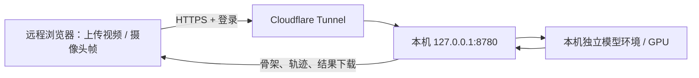

# 将本机部署成远程推理网页

MonkeyPoseLive 的网页模式由一台 Windows 主机加载既有姿态模型。其他电脑打开 HTTPS 地址、登录后上传视频，或授权自己电脑的浏览器摄像头。客户端不需要安装 Python、CUDA 或模型权重。桌面版仍可独立使用。



推理在主机进行。使用 Cloudflare 时，传输经过其网络，浏览器到 Cloudflare 的 HTTPS 在其边缘终止；这不是浏览器到主机的端到端加密。请只提交有权通过该网络处理的素材。上传文件和启用保存后的结果留在主机的私有数据目录，不进入 GitHub。登录口令、会话、模型路径、主机文件浏览和桌面设置不会作为公共接口发布。

## 主机准备

1. 保持这台主机联网且不休眠。先确认需要的后端环境和权重可用；网页模式复用本机身体模型配置，面部模式读取同一私有JSON中的 `face_models`。配置字段见 [BACKENDS.md](BACKENDS.md)。
2. 使用仓库源码以及已安装 `requirements-web.txt` 的 Python 环境。Windows v0.1.0 的桌面 EXE 不包含后续加入的远程网页入口。
3. 在仓库目录打开 PowerShell。网页运行数据默认位于 `%LOCALAPPDATA%\MonkeyPoseLive\web`；可用 `-DataDirectory` 指定另一个专用私有目录。该目录必须支持 Windows 文件访问控制，例如本机 NTFS；exFAT 便携盘无法保存所需访问权限，脚本会拒绝启动。不要使用源码目录、发布目录、共享盘根目录或研究资料总目录。

仅本机预览：

```powershell
.\Start-Web.ps1 -PythonExecutable 'C:\path\to\python.exe' -ConfigPath 'C:\private\config.json'
```

打开 `http://127.0.0.1:8780`。启动不会打开主机摄像头或加载模型。首次运行生成随机口令，明文保存在私有目录的 `access.txt`，方便主机管理者读取；`auth.json` 保存用于校验的口令哈希。启动脚本只显示该文件位置，不在进程参数或日志中输出口令。不要把此文件、`auth.json`、`launch.json`、服务描述文件或日志上传到 GitHub。

主机服务始终只绑定 loopback。`Start-Web.ps1` 不修改路由器、防火墙、Windows 服务或自动启动设置，也不会代理已存在的桌面服务。

## 跨网络临时访问

安装经过固定 SHA256 校验的官方便携版连接器；此操作只下载工具，不创建隧道：

```powershell
.\Install-WebTunnel.ps1
```

启动临时 HTTPS 地址：

```powershell
.\Start-Web.ps1 -PythonExecutable 'C:\path\to\python.exe' -ConfigPath 'C:\private\config.json' -QuickTunnel
```

脚本先确认 8780 端口空闲，再取得临时域名，最后启动只接受此 HTTPS origin 和本地管理请求的受登录保护服务。连接器日志、进程标识和管理令牌写入私有数据目录。脚本创建的后台窗口为隐藏状态。

把输出的 `https://….trycloudflare.com` 地址与登录口令分别交给需要使用的人。每次重新创建临时隧道，网址都会变化；关闭隧道后原网址失效。[Cloudflare Quick Tunnels](https://developers.cloudflare.com/tunnel/get-started/quick-tunnels/) 无需账户或域名，但仅供测试和开发，没有可用性保证，最多 200 个同时在途请求，且不支持 SSE。

远程使用步骤：

1. 用现代浏览器打开 HTTPS 地址并登录；右上角可选择中文或日本語，选择保存在当前浏览器。
2. 上传视频，或选择“浏览器摄像头”。摄像头指访问者电脑上的设备，需要该访问者明确授权；不会远程打开服务器上的 USB 摄像头。
3. 开始前选择已就绪模型、单猴 ROI、显示阈值和结果保存选项，再查看结果。五个身体模型输出各自的原生关节点；PrimateFace面部模式输出68点；表情模式显示四类面部显示分数。更改任务配置时结束当前任务后重新开始。
4. 结束任务后按需下载该登录会话自己的结果，并停止摄像头。

浏览器摄像头依赖安全上下文，远程应使用 HTTPS；本机 localhost 是浏览器允许的特殊情况。直接用另一台电脑访问普通 HTTP 的主机 IP，无法获得同等摄像头能力。参见 [MDN getUserMedia](https://developer.mozilla.org/en-US/docs/Web/API/MediaDevices/getUserMedia)。

分析画面不再绘制蓝色历史拖尾；保留当前帧的有效点位与连接。身体／面部关键点的坐标和关节曲线仍然可用。表情模式不生成关节曲线，其分类分数与“是否检出脸”一起展示；`neutral`、`lipsmack`、`threat`、`fearful` 是作者类别，不是对动物内部情感的直接测量。

## 停止与保留文件

```powershell
.\Stop-Web.ps1
```

若启动时指定了数据目录，停止时传入相同目录：

```powershell
.\Stop-Web.ps1 -DataDirectory 'C:\private\MonkeyPoseLiveWeb'
```

停止脚本先关闭本次启动的外网连接器，再向本机带管理令牌的接口请求关闭服务。它同时校验 PID、启动时间和 EXE 路径；不会按进程名批量结束 Python、cloudflared 或其他服务。历史运行描述、上传文件和结果保留，不自动删除。若服务未能及时退出，脚本会保留记录并报告错误，外网隧道已经关闭。

## 固定网址与长期运行

临时隧道适合先试用。需要固定网址时，使用自己的 Cloudflare 账户与已管理域名创建命名隧道，配置公开域名指向 `http://127.0.0.1:8780`，并优先增加 Cloudflare Access 的访问者限制。官方步骤见 [创建 Cloudflare Tunnel](https://developers.cloudflare.com/cloudflare-one/networks/connectors/cloudflare-tunnel/get-started/create-remote-tunnel/)。账户授权、域名和隧道令牌留在主机，不能写入源码。

已配置好固定隧道时，先按精确域名启动应用，再由管理员单独运行该隧道：

```powershell
.\Start-Web.ps1 -PythonExecutable 'C:\path\to\python.exe' -ConfigPath 'C:\private\config.json' -PublicUrl 'https://pose.example.org'
```

`-PublicUrl` 只设置应用接受的外部 origin，不创建 DNS、TLS 证书或命名隧道。`Stop-Web.ps1` 只管理自己创建的临时连接器；管理员另行管理的命名隧道需要由管理员停止。可以在 Cloudflare 管理页面撤销入口。不要将旧桌面版端口直接公开。

连接器官方来源：[cloudflared Windows 下载说明](https://developers.cloudflare.com/cloudflare-one/networks/connectors/cloudflare-tunnel/downloads/)、[2026.10.1 发布](https://github.com/cloudflare/cloudflared/releases/tag/2026.10.1)。安装脚本固定 Windows amd64 EXE 的 SHA256 为 `4d2490e74082c5d48dbfedaf92576fa5bd1702379ab88eb7faa0cfbe8dc891b6`；更新版本时应同时核验官方发布资产摘要。工具未随仓库分发，其上游许可独立适用。

## 使用边界

上传速度取决于客户端上行网络和隧道，摄像头延迟还包括网络往返与模型推理。摄像头采用最新帧策略，慢模型会跳过输入帧；上传视频逐个处理所有成功解码的帧，处理速度取决于模型，当前限制每个视频不超过 600 秒、18,000 帧。为避免多个任务争用同一 GPU，一个推理槽位由当前任务持有；其他登录会话不能接管、读取或停止其任务。

骨架、面部点及表情分类均为自动预测，遮挡、笼条和模型原生点位差异仍需人工检查。四类面部表情softmax未在本项目专家评定状态上校准。本服务不提供经过验证的解剖准确率、3D 重建或动物内部情感判断。USB、远程浏览器实体摄像头和长期运行性能应在实际设备及网络中验证。
